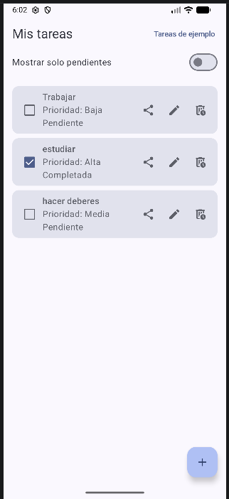
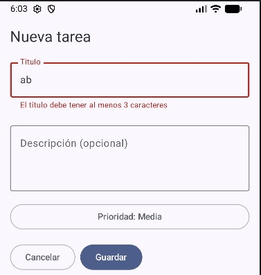
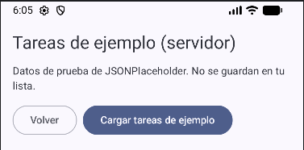
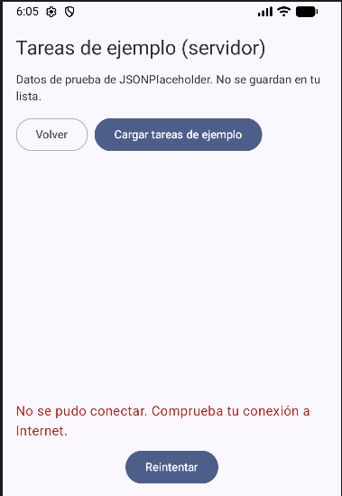
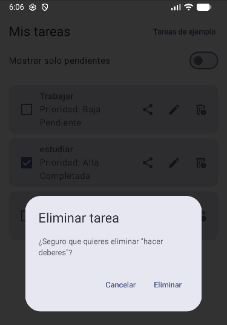
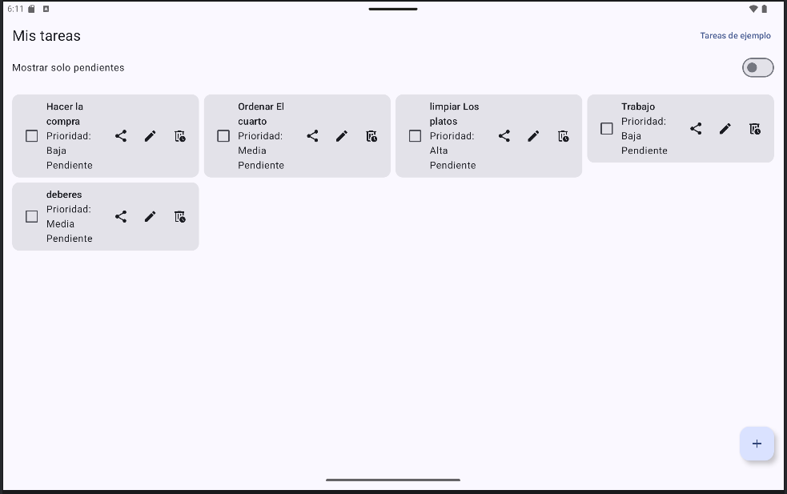

# Gestor Personal de Tareas

**Módulo:** Programación Multimedia y Dispositivos Móviles (PMDM)
**Autor:** Joaquín Torrubia Oria
**Tecnologías:** Kotlin · Jetpack Compose · Material 3 · Room · DataStore · Retrofit

## 1. Descripción

Aplicación Android para organizar tareas personales, académicas o profesionales. Permite crear, consultar, editar, completar y eliminar tareas, que se guardan de forma permanente en una base de datos local (Room). Además:

- recuerda la preferencia **«Mostrar solo pendientes»** entre ejecuciones (DataStore);
- consulta **tareas de ejemplo** en un servicio web REST (JSONPlaceholder) mediante Retrofit;
- permite **compartir** una tarea con otras aplicaciones mediante un Intent implícito.

## 2. Funcionalidades implementadas

| Requisito del enunciado | Estado | Dónde está |
|---|---|---|
| 3.1 Listado con `LazyColumn` / cuadrícula, mensaje si está vacía | ✅ | `ui/screens/ListaTareasScreen.kt` |
| 3.2 Formulario con título, descripción y prioridad (desplegable) | ✅ | `ui/screens/FormularioTareaScreen.kt` |
| 3.2 Validaciones (vacío, solo espacios, mínimo 3 caracteres) con error junto al campo | ✅ | `validarTitulo()` en `FormularioTareaScreen.kt` |
| 3.2 Sin duplicados por pulsar Guardar varias veces | ✅ | Variable `guardando` en `FormularioTareaScreen.kt` |
| 3.3 Editar, marcar como completada y eliminar con `AlertDialog` | ✅ | `ListaTareasScreen.kt`, `TareasViewModel.kt` |
| 3.4 Persistencia con Room (entidad, DAO, base de datos) | ✅ | `model/Tarea.kt`, `data/local/` |
| 3.5 Switch «Mostrar solo pendientes» guardado con DataStore | ✅ | `data/prefs/PreferenciasRepositorio.kt` |
| 3.6 Tareas de ejemplo con Retrofit (carga, error y reintento) | ✅ | `data/remote/`, `ui/EjemplosViewModel.kt`, `ui/screens/EjemplosScreen.kt` |
| 3.7 Compartir con `ACTION_SEND` y selector de aplicaciones | ✅ | `ui/Compartir.kt` |
| 4.4 Iconos locales (Vector Assets) | ✅ | `res/drawable/ic_anadir`, `ic_editar`, `ic_eliminar`, `ic_compartir` |
| 4.4 Adaptación a dos tamaños de pantalla | ✅ | `LazyVerticalGrid` con `GridCells.Adaptive(300.dp)` |
| 4.5 Permiso `INTERNET` (y ningún otro) | ✅ | `AndroidManifest.xml` |

## 3. Organización del proyecto

```
com.joaquin.gestor_tareas_pmm
├── model/
│   └── Tarea.kt                    → data class Tarea (@Entity) + enum Prioridad
├── data/
│   ├── local/
│   │   ├── TareaDao.kt             → consultas Room (Flow + funciones suspend)
│   │   └── TareasDatabase.kt       → base de datos Room (Singleton)
│   ├── prefs/
│   │   └── PreferenciasRepositorio.kt → lectura/escritura con Preferences DataStore
│   └── remote/
│       ├── TareaRemota.kt          → modelo del JSON de JSONPlaceholder
│       ├── TareasApi.kt            → interfaz Retrofit (GET /todos?userId=1)
│       └── ClienteRetrofit.kt      → cliente Retrofit (Singleton)
├── ui/
│   ├── screens/
│   │   ├── ListaTareasScreen.kt    → lista/cuadrícula, filtro, diálogo de borrado
│   │   ├── FormularioTareaScreen.kt→ crear y editar (mismo formulario)
│   │   └── EjemplosScreen.kt       → tareas del servidor
│   ├── theme/                      → tema Material 3
│   ├── Pantalla.kt                 → enum de navegación (LISTA, FORMULARIO, EJEMPLOS)
│   ├── EstadoEjemplos.kt           → sealed interface: Inicial, Cargando, Exito, Error
│   ├── TareasViewModel.kt          → tareas personales (Room + DataStore)
│   ├── EjemplosViewModel.kt        → tareas de ejemplo (Retrofit)
│   └── Compartir.kt                → función compartirTarea() con Intent
└── MainActivity.kt                 → única Activity: navegación por estado
```

## 4. Decisiones de diseño

- **Navegación por estado con un `enum Pantalla`** guardado con `rememberSaveable`. No hace falta una librería de navegación para tres pantallas, y el enum sobrevive a la rotación sin configuración extra. El botón «atrás» del sistema se gestiona con `BackHandler`.
- **Un mismo formulario para crear y editar.** Recibe `tareaInicial: Tarea?`: si es `null` se crea una tarea; si tiene valor, se edita conservando su `id` y su estado `completada`.
- **El borrador del formulario vive en la pantalla** (`rememberSaveable`), porque es estado temporal de la interfaz. El ViewModel solo recibe la tarea cuando ya es válida.
- **Validación en la capa de interfaz.** No se usa `require` en el modelo porque lanzaría una excepción y cerraría la app; el enunciado pide un mensaje junto al campo.
- **Una sola clase `Tarea` como modelo y entidad de Room**, para no duplicar código en una app pequeña. Los nombres internos del enum (`BAJA`, `MEDIA`, `ALTA`) no se cambian porque Room los guarda como texto; el texto visible está en la propiedad `etiqueta`.
- **State hoisting:** las pantallas reciben datos y lambdas, no el ViewModel. Así se pueden previsualizar con `@Preview` y datos inventados.
- **Dos ViewModels separados:** `TareasViewModel` (`AndroidViewModel`, necesita `Context` para Room y DataStore) y `EjemplosViewModel` (ViewModel normal).
- **`StateFlow` + `stateIn(WhileSubscribed(5000))`** para exponer los `Flow` de Room y DataStore a Compose sin reiniciar la consulta al girar la pantalla.
- **`sealed interface EstadoEjemplos`** para que la pantalla de ejemplos solo pueda estar en un estado a la vez.
- **Tareas personales y de ejemplo, conjuntos distintos:** `Tarea` (Room) y `TareaRemota` (Retrofit) son clases diferentes, y las de ejemplo nunca se guardan en la base de datos.
- **Evitar el operador `!!`:** se copia el valor a un `val` local para que funcione el *smart cast*.
- **Cuadrícula adaptativa** (`GridCells.Adaptive(minSize = 300.dp)`): una columna en el móvil en vertical y varias en horizontal o en la tablet, con el mismo código.

## 5. Bibliotecas utilizadas

| Biblioteca | Versión | Uso |
|---|---|---|
| Jetpack Compose (BOM) | 2026.02.01 | Interfaz |
| Material 3 | (BOM) | Componentes visuales |
| Lifecycle ViewModel Compose | 2.11.0 | ViewModel desde Compose |
| Room (runtime, ktx, compiler) | 2.8.5 | Base de datos local |
| KSP | 2.3.10 | Generación de código de Room |
| DataStore Preferences | 1.3.0 | Preferencia «solo pendientes» |
| Retrofit | 3.0.0 | Cliente HTTP REST |
| Converter Gson | 3.0.0 | Conversión de JSON a objetos Kotlin |
| Kotlin Coroutines | (incluida) | Operaciones asíncronas |

Configuración: Android Gradle Plugin 9.4.1 (Kotlin integrado), Kotlin 2.2.10, `minSdk 24`, `targetSdk 37`.

## 6. Cómo ejecutar la aplicación

**Desde Android Studio**
1. Clonar el repositorio y abrirlo con *File → Open*.
2. Esperar a que termine la sincronización de Gradle.
3. Elegir un emulador o dispositivo y pulsar ▶ *Run*.

**Con el APK**
1. Descargar `apk/app-debug.apk` de este repositorio.
2. Arrastrarlo sobre un emulador, o copiarlo a un dispositivo Android 7.0 (API 24) o superior y abrirlo (puede ser necesario permitir la instalación de orígenes desconocidos).

## 7. Emuladores utilizados

| | Emulador 1 (pantalla compacta) | Emulador 2 (pantalla grande) |
|---|---|---|
| Perfil | Medium Phone | Medium Tablet |
| Versión de Android | Android 17.0 (API 37) | Android 16.0 «Baklava» (API 36) |
| Arquitectura | x86_64 | x86_64 |
| Resolución / densidad | <!-- rellenar desde Device Manager --> | <!-- rellenar --> |

## 8. Pruebas realizadas

Todas las pruebas se han realizado en los dos emuladores y han dado el resultado esperado (✅).

| Nº | Prueba | Resultado esperado | Móvil | Tablet |
|---|---|---|---|---|
| 1 | Crear una tarea válida | Se guarda y aparece en la lista | ✅ | ✅ |
| 2 | Guardar con título vacío | Error junto al campo; no se crea la tarea | ✅ | ✅ |
| 3 | Editar una tarea | Los cambios se muestran correctamente | ✅ | ✅ |
| 4 | Marcar como completada | Su estado cambia y queda guardado | ✅ | ✅ |
| 5 | Cancelar una eliminación | La tarea no desaparece | ✅ | ✅ |
| 6 | Eliminar confirmando | La tarea desaparece de la base de datos | ✅ | ✅ |
| 7 | Cerrar y volver a abrir la app | Se recuperan las tareas guardadas | ✅ | ✅ |
| 8 | Activar el filtro y reiniciar | Se conserva la preferencia | ✅ | ✅ |
| 9 | Consultar la API con Internet | Se muestran las tareas recibidas | ✅ | ✅ |
| 10 | Consultar la API sin conexión (modo avión) | Mensaje de error y botón «Reintentar» | ✅ | ✅ |
| 11 | Compartir una tarea | Se abre el selector de aplicaciones | ✅ | ✅ |
| 12 | Girar el dispositivo (lista, formulario, edición, ejemplos) | La app sigue funcionando y conserva los datos | ✅ * | ✅ * |

\* El diálogo de eliminar se cierra al girar (ver «Incidencias conocidas»); la tarea no se borra y la app sigue funcionando.

Pruebas adicionales:

| Prueba | Resultado esperado | Resultado |
|---|---|---|
| Título de 2 caracteres | Error «al menos 3 caracteres» | ✅ |
| Pulsar Guardar muchas veces seguidas | La tarea se crea una sola vez | ✅ |
| Pulsar «Cargar» mientras carga | El botón está desactivado | ✅ |
| Compartir una tarea sin descripción | No aparece la línea «Descripción:» | ✅ |
| Botón «atrás» en el formulario o en ejemplos | Vuelve a la lista sin cerrar la app | ✅ |
| Database Inspector | La tabla `tareas` contiene las filas reales | ✅ |

## 9. Capturas de pantalla

### Listado principal (móvil)
Lista de tareas personales con su prioridad y estado, el Switch «Mostrar solo pendientes», los botones de compartir, editar y eliminar, y el botón «+» para añadir.



### Formulario de creación con validación
Al intentar guardar un título de menos de 3 caracteres, el campo se marca en rojo y se muestra el mensaje de error justo debajo. La tarea no se guarda.



### Tareas de ejemplo (API REST)
Pantalla que consulta JSONPlaceholder con Retrofit. Estas tareas son de solo lectura y no se guardan en la lista personal.



### Error sin conexión
Con el modo avión activado, la consulta falla y se muestra un mensaje de error con el botón «Reintentar».



### Confirmación de eliminación
Antes de borrar una tarea se pide confirmación con un `AlertDialog`. Si se pulsa «Cancelar», la tarea no se elimina.



### Tablet: cuadrícula adaptativa
En pantallas grandes, la lista se muestra en varias columnas gracias a `LazyVerticalGrid` con `GridCells.Adaptive`.



## 10. Uso de IA

Durante el desarrollo se ha utilizado un asistente de IA para explicar conceptos (Room, DataStore, Retrofit, coroutines, state hoisting...), revisar código, resolver errores de configuración de Gradle y preparar esta documentación.

- Enlace al chat: https://claude.ai/share/7d99aef6-5e73-4c3a-993f-b22d83c3f1dc

## 11. Incidencias conocidas

- **Parpadeo del filtro al arrancar:** si el filtro estaba activado, durante un instante pueden verse todas las tareas hasta que DataStore devuelve el valor guardado (el valor inicial de `stateIn` es `false`).
- **El diálogo de eliminación se cierra al girar el dispositivo:** su estado usa `remember`. La tarea no se elimina; solo hay que volver a pulsar la papelera.
- **Sin gestión de errores en las operaciones de Room:** no se capturan excepciones de la base de datos local, por ser muy poco probables en este contexto.
- **Lectura de DataStore sin `.catch`:** si el fichero de preferencias se corrompiera, la lectura lanzaría una `IOException` que no se captura.
- **Gson y campos nulos:** Gson crea los objetos sin usar el constructor de Kotlin; si la API omitiera un campo, quedaría `null` aunque el tipo no lo permita. Con JSONPlaceholder no ocurre.
- **Textos en el código:** los textos de la interfaz y las etiquetas de prioridad no están en `strings.xml`, por lo que la aplicación no está preparada para traducirse.
- **Títulos en pseudolatín:** las tareas de ejemplo aparecen con textos como «delectus aut autem» porque son los datos de prueba que devuelve JSONPlaceholder.
